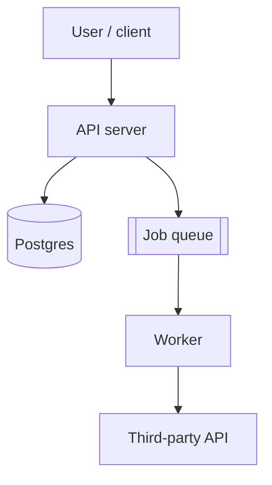
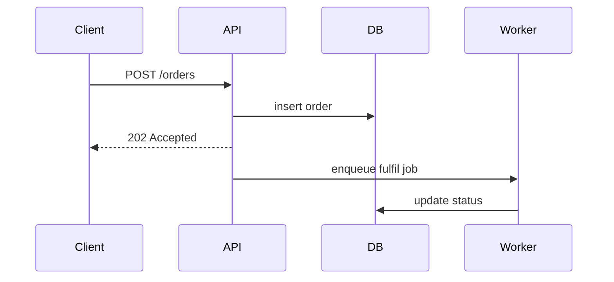
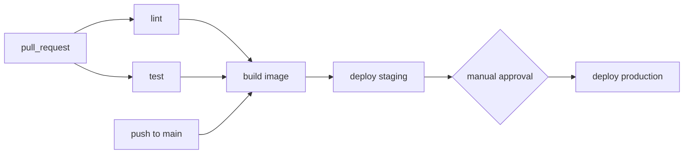

# Overview template

Fill in what applies and drop what doesn't. Cite a source file for each claim
and mark guesses *(inferred)*. Replace every `<…>`.

````markdown
# <repo name>: overview

> Generated from `<branch>` @ `<short sha>` on <date>. Read-only scan; claims cite their source files.

## TL;DR

- **What:** <one sentence: what it is and who uses it>
- **Built with:** <main language/framework, runtime, datastore>
- **Ships via:** <CI system → artifact → where it runs>

## What it does

<2–5 sentences: purpose, main features or responsibilities, what it depends on
and what depends on it.> (source: `README.md`)

## Tech stack

| Layer | Technology | Version | Source |
|-------|------------|---------|--------|
| Language | <e.g. TypeScript> | <5.x> | `package.json` |
| Runtime | <Node.js> | <20> | `.nvmrc` |
| Framework | <…> | <…> | <…> |
| Data | <Postgres via ORM> | <…> | `docker-compose.yml` |
| Tests | <…> | | <…> |
| Lint/format | <…> | | <…> |
| Build/package | <…> | | <…> |
| Infra/deploy | <…> | | <…> |

## Code map

```text
<top-level tree, 1 line per important dir>
src/
├── api/        # HTTP handlers
├── domain/     # business logic
└── db/         # models and migrations
```

**Entry points:** <`cmd/server/main.go` (HTTP server), `cmd/worker/main.go` (queue consumer)>
**Generated/vendored (don't edit by hand):** <…>
**Tests:** <where, what kinds, how they run>

## Run it locally

```bash
<setup command>      # from <file>
<run command>
<test command>
<lint command>
```

Needs: <services, e.g. Postgres and Redis via docker-compose>. Env vars (names): `<VAR_A>`, `<VAR_B>` (see `.env.example`).

## Architecture



## Key workflows

### <Workflow name, e.g. "Create order">



<2–3 sentences on what happens and where the code lives.>

## CI/CD pipeline



| Workflow | Triggers | Jobs | Gates / environments | Produces |
|----------|----------|------|----------------------|----------|
| `<ci.yml>` | `pull_request`, `push: main` | lint, test, build | none | test reports |
| `<deploy.yml>` | `push: main`, tags `v*` | build, deploy | `production` (approval) | image `<registry>/<name>` |

Runners: <GitHub-hosted / self-hosted labels>. Reusable workflows: <`org/repo/.github/workflows/x.yml@ref`> (logic lives outside this repo). Action pinning: <SHA / tags>.

## PR checks and merge rules

- **Checks that run on a PR:** <job names>
- **Required to merge:** <from rulesets/branch protection, or "couldn't read: needs admin / gh not authenticated">
- **Reviews:** <N approvals; CODEOWNERS for `<paths>`>
- **Merge method / queue:** <squash only, merge queue, linear history…>
- **Local hooks:** <pre-commit / husky: what they run>
- **Bots:** <Dependabot / Renovate cadence, labelers, Danger>

## Deploy and environments

| Environment | How it deploys | Trigger | Config |
|-------------|----------------|---------|--------|
| <staging> | <Helm via ArgoCD> | <merge to main> | `<deploy/staging/>` |
| <production> | <…> | <tag + approval> | `<…>` |

Release/versioning: <semantic-release / tags / manual>. Rollback: <documented path, or "none documented">.
Integrations: <DB, queue, cache, third-party APIs, feature flags (names only)>.

## Conventions

- Commits: <Conventional Commits / free-form> (from `git log`)
- Branches: <pattern>
- Style: <formatter/linter, enforced in CI?>
- Docs to update with changes: <CHANGELOG, README inventory, ADRs…>

## Gotchas and health

- **Hotspots (last 90 days):** `<file>` (<n> changes), …
- **Debt markers:** <n> TODO/FIXME, mostly in `<dir>`
- **Gaps / risks:** <e.g. tests not run in CI, unpinned actions, no lockfile, `pull_request_target` with PR checkout, docs disagree with config>
- **Surprises:** <non-obvious behaviour a newcomer would trip on>

## Open questions

- <things the repo doesn't answer, e.g. "Where are production secrets managed?">

## Where to start

1. `<file>`: <why read it first>
2. `<file>`: <…>
3. `<file>`: <…>
````

## Mermaid tips

- Quote labels with spaces or punctuation: `api["API server (v2)"]`.
- Node IDs: letters, digits, underscores only. Avoid reserved words like `end`
  as IDs.
- Shapes: `[("db")]` for a database, `[["queue"]]` for a subroutine/queue,
  `{"gate"}` for a decision.
- Use `subgraph name["Label"] … end` to group by environment or service.
- Keep each diagram under ~20 nodes. Split rather than cram.
